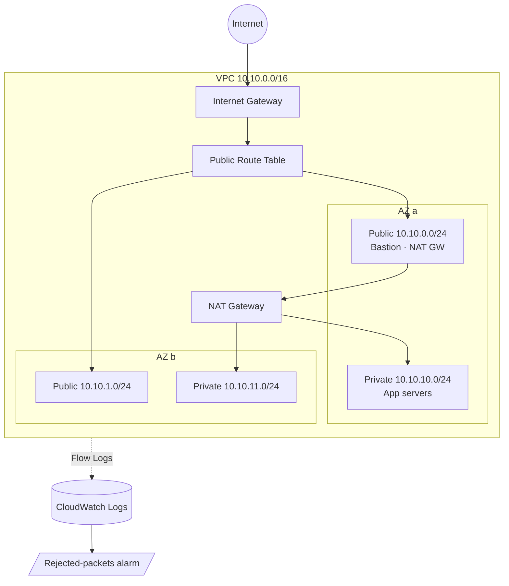

# AWS VPC Infrastructure with Terraform


A reusable AWS network built with Terraform modules. It creates a multi-AZ VPC with public and private subnets, NAT gateways, a Network ACL, VPC Flow Logs with a rejected-traffic alarm, and a three-tier security group layout (bastion → web → app).

## Architecture



## Features

| Area | What it does |
|---|---|
| **Multi-AZ subnets** | One public and one private subnet per AZ (2–6 AZs), sized automatically with `cidrsubnet()` |
| **NAT modes** | `single_nat_gateway = true` for cheap dev, `false` for one NAT per AZ in production |
| **Routing** | Shared public route table via the IGW, and a private route table per AZ via NAT |
| **Network ACL** | Stateless second layer on private subnets: intra-VPC traffic plus ephemeral return ports |
| **Security groups** | Bastion accepts SSH from admin IPs only, web accepts HTTP/S plus bastion SSH, app accepts web-tier traffic only |
| **Monitoring** | VPC Flow Logs → CloudWatch, a metric filter on `REJECT`, and an alarm on spikes |
| **Guardrails** | Input validation rejects non-/16 CIDRs and SSH open to `0.0.0.0/0` |
| **CI** | GitHub Actions runs `terraform fmt`, `init` and `validate` on every push |

## Project Structure

```
.
├── modules/
│   ├── vpc/          # VPC, subnets, IGW, NAT, routes, NACL, flow logs, alarm
│   └── security/     # bastion / web / app security groups
├── environments/
│   └── dev/          # root module that wires the modules together
└── .github/workflows/terraform.yml
```

## Usage

Requirements: Terraform ≥ 1.5 and AWS credentials (`aws configure`).

```bash
cd environments/dev
cp terraform.tfvars.example terraform.tfvars   # set admin_cidrs to your IP
terraform init
terraform plan
terraform apply
```

NAT gateways are billed hourly, so destroy the stack when you're finished:

```bash
terraform destroy
```

## Outputs

| Output | Description |
|---|---|
| `vpc_id` | ID of the VPC |
| `public_subnet_ids` | Public subnet IDs, one per AZ |
| `private_subnet_ids` | Private subnet IDs, one per AZ |
| `nat_gateway_public_ips` | Elastic IPs of the NAT gateway(s) |
| `security_group_ids` | Map of bastion / web / app SG IDs |

## Design Decisions

- **Why /24 subnets at fixed offsets?** Public subnets use indexes 0–5 and private subnets use 10–15, so new AZs can be added without re-numbering existing subnets.
- **Why both SGs and a NACL?** Security groups are stateful and attach to instances. The NACL is a stateless subnet-level backstop in case an SG is misconfigured.
- **Why alarm on REJECTs?** A sudden jump in rejected flows usually means a broken rule after a change, or someone scanning the network.

## References

- [AWS VPC User Guide](https://docs.aws.amazon.com/vpc/latest/userguide/)
- [terraform-aws-modules/terraform-aws-vpc](https://github.com/terraform-aws-modules/terraform-aws-vpc) (design inspiration)
- [Terraform AWS Provider](https://registry.terraform.io/providers/hashicorp/aws/latest/docs)

## License

MIT
